  

 

  

**Egresado de Ingeniería en Sistemas.** Construyo sitios web ligeros, automatizo tareas con Python y GitHub Actions, y trabajo con IA (Claude Code, MCP) para crear herramientas propias. 
También enseño optimización de PC y videojuegos: más FPS, menos latencia y configuraciones estables, medidas y explicadas para que cualquiera las aplique.

 

 

 

<picture>
  <source media="(prefers-color-scheme: dark)" srcset="https://raw.githubusercontent.com/eito-tv/eito-tv/output/pacman-contribution-graph-dark.svg">
  <source media="(prefers-color-scheme: light)" srcset="https://raw.githubusercontent.com/eito-tv/eito-tv/output/pacman-contribution-graph.svg">
  
</picture>

