  

 

  

Ingeniero en Sistemas y creador de contenido. 
Enseño a optimizar videojuegos: más FPS, menos latencia y configuraciones estables, explicado para que cualquiera pueda aplicarlo. 
Comunidad de Left 4 Dead en Discord. Entra y juega con nosotros.

 

 

